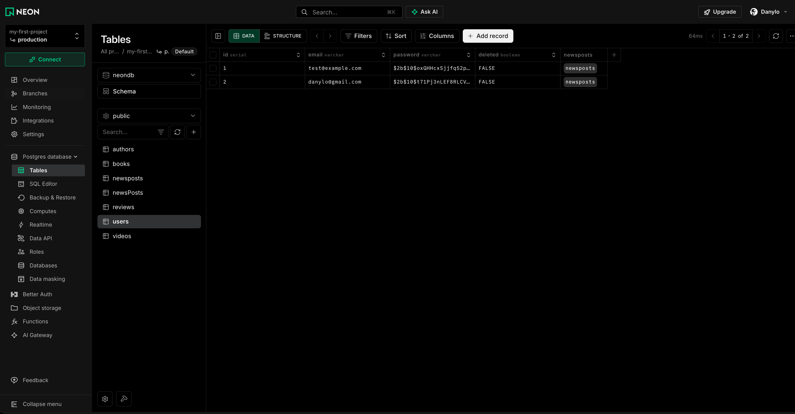
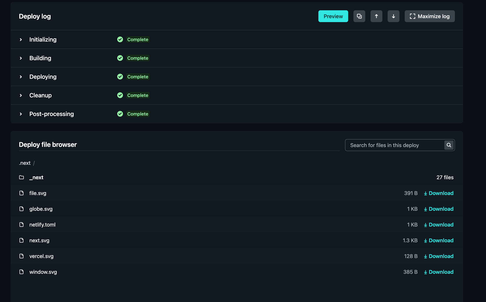
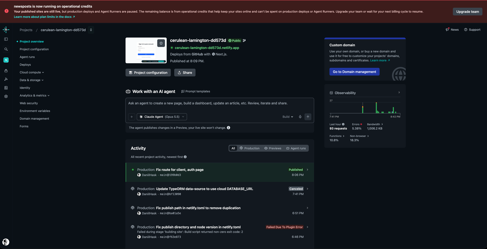

# Continuous integration systems (HW 15)
## NodeJS HW-15
Додати до новинного сервісу CI (GitHub actions) та CD (задеплоїти на будь-який хостинг)

## Технічні вимоги

* Додати до вашого репозиторію GitHub actions на пуш в основну гілку та пул реквести в неї. Серед actions обов'язково мають бути наступні етапи:
  * Інсталювання NPM пакетів
  * Білд з тайпскрипта у джаваскрипт
  * Перевірка стилів (eslint)
* Задеплоїти новинний сервіс на будь-який безкоштовних хостинг (https://www.cyclic.sh/ або https://www.netlify.com/) з автоматичним оновленям з репозиторію у разі додавання до нього змін. Для хостингу бази у клауді можна використати https://www.elephantsql.com/

# Result

https://cerulean-lamington-dd573d.netlify.app

1. 

2. 

3. 