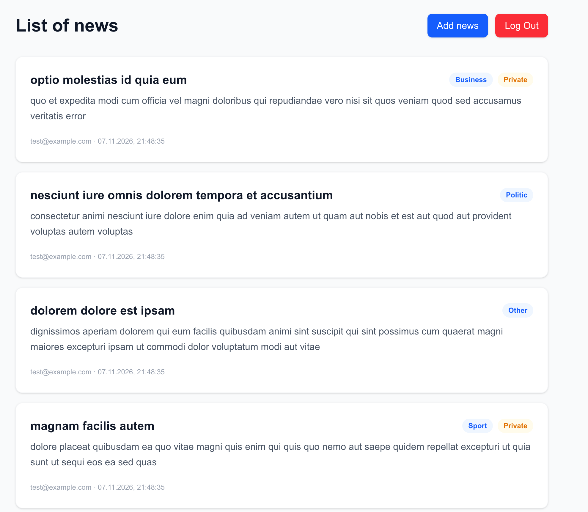

#  Databases and SQL (HW 14)
## NodeJS HW-14 (Transactions and migrations)
Додати в новинний сервіс seeding та migrations, використовуючи TypeORM.

## Технічні вимоги

* Створити seed, який запише в базу одного стандартного користувача та 20 новин, контент яких треба згенерувати за допомогою faker або https://jsonplaceholder.typicode.com/

* Додати міграцію яка:
  * a. Додасть нове поле deleted до таблиць posts та users, яке за замовчування дорівнює false
  * b. Перейменує колонку title на header у таблиці posts
* Прийняти рішення та додати індекси до тих колонок таблиць, які ви вважаєте необхідними

# Result

1. 

2. 