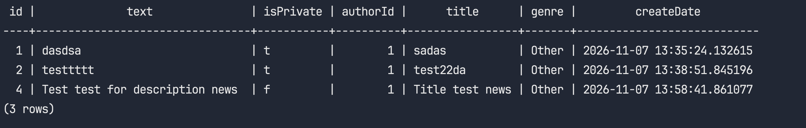
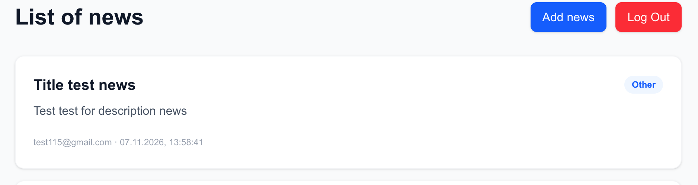
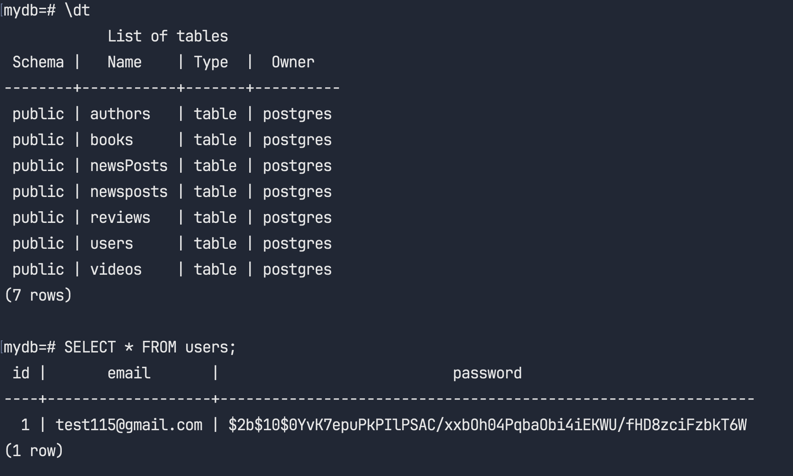

#  Databases and SQL (HW 13)
## NodeJS HW-13 (TypeORM)
Додати в новинний сервіс TypeORM та замінити fileDB, або якщо використовуєте knex.js або Sequelize то замінити їх

## Технічні вимоги

Створити entity для моделей User та Newspost.

```
// User schema
{
  email: String,
  password: String
}
// Newspost schema
{
  title: String,
  text: String,
  author: User
}
```
Реалізувати таку функціональність

* Усі нові новини при створенні мають мати автором залогіненгого користувача
* На сторінці перегляду усіх новин потрібно відображати емейл користувача, який додав цю новину
* На головній сторінці для кожної новини потрібно відображати емейл користувача, який додав цю новину

# Result

1. 

2. 

3. 